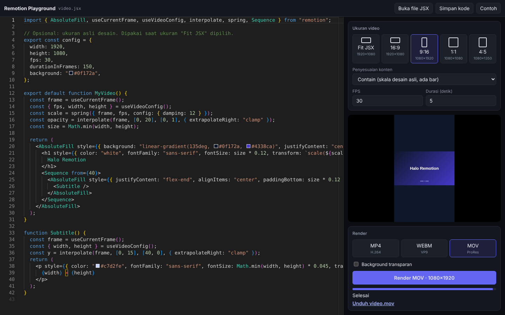

# Remotion Playground



Tulis kode JSX Remotion, lihat preview langsung, lalu render ke **MP4 / WebM / MOV** dengan ukuran **Fit JSX, 16:9, 9:16, 1:1, atau 4:5**.

## Menjalankan

```bash
npm install
npm run dev          # web: http://localhost:5173  ·  API render: http://localhost:3001
```

Produksi (satu server untuk web + API):

```bash
npm run build && npm start   # http://localhost:3001
```

Saat pertama kali render, Remotion akan mengunduh Chrome Headless Shell. Kalau sudah ada Chrome/Chromium di mesin,
arahkan ke sana: `REMOTION_BROWSER_EXECUTABLE=/path/ke/chrome npm run dev`.

## Menulis kode

```jsx
import { AbsoluteFill, useCurrentFrame, interpolate } from "remotion";

// Opsional — dipakai oleh pilihan ukuran "Fit JSX"
export const config = { width: 1920, height: 1080, fps: 30, durationInFrames: 150, background: "#000" };

export default function MyVideo() {
  const frame = useCurrentFrame();
  return <AbsoluteFill style={{ opacity: interpolate(frame, [0, 30], [0, 1]) }}>Halo</AbsoluteFill>;
}
```

- Yang bisa di-`import`: `react` dan `remotion` (semua ekspor `remotion` juga tersedia tanpa import).
  Tambah library lain di objek `MODULES` pada `src/compile.ts`.
- Tombol **Buka file JSX** memuat file `.jsx/.tsx` dan otomatis memilih **Fit JSX**.

## Ukuran & penyesuaian konten

| Preset | Ukuran |
|---|---|
| Fit JSX | dari `export const config` (default 1920×1080) |
| 16:9 | 1920×1080 |
| 9:16 | 1080×1920 |
| 1:1 | 1080×1080 |
| 4:5 | 1080×1350 |

Jika preset berbeda dari ukuran desain di config:
- **Responsif** — kanvas berubah; konten menyesuaikan sendiri via `useVideoConfig()` / `AbsoluteFill`.
- **Contain** — desain asli diskalakan utuh, sisa area diisi `config.background`.
- **Cover** — desain asli diskalakan memenuhi kanvas, tepi terpotong.

Pada Contain/Cover, `useVideoConfig()` di kode tetap mengembalikan ukuran desain asli.

## Format render

| Format | Codec | Transparan |
|---|---|---|
| MP4 | H.264 | – |
| WebM | VP9 | ✓ (`yuva420p`) |
| MOV | ProRes HQ / 4444 | ✓ (ProRes 4444) |

## Struktur

```
src/compile.ts        JSX → komponen (Babel standalone, dipakai di browser & renderer)
src/sizes.ts          preset ukuran
src/remotion/         komposisi "Runner" (dipakai Player dan server render)
src/App.tsx           UI: editor Monaco, pengaturan, Player, panel render
server/index.ts       Express: antrean render, progres, unduh hasil
```

## Catatan produksi

- Kode pengguna dieksekusi apa adanya (di browser dan di Chrome headless server). Untuk aplikasi publik,
  jalankan render di container terisolasi dan batasi akses jaringannya.
- Antrean job disimpan di memori dan render dijalankan satu per satu; hasil dihapus setelah 1 jam.
  Untuk skala besar, ganti dengan BullMQ/Redis atau Remotion Lambda.
- Lisensi Remotion: gratis untuk individu & tim kecil; perusahaan lebih besar perlu company license (remotion.dev/license).
